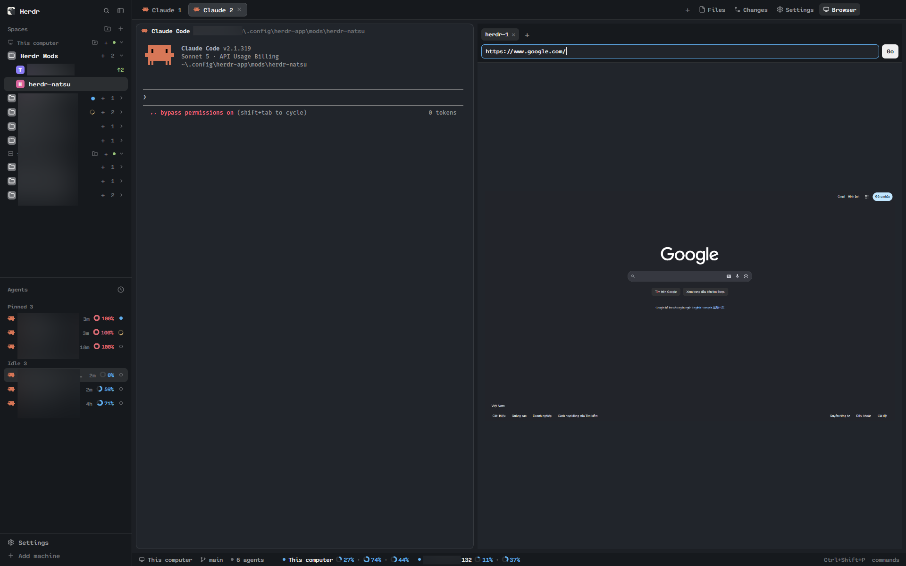

# Herdr Natsu

A bundle of six [Herdr](https://herdr.dev) mods, one layout (`natsu`) that wires
them together, and three MCP servers (`natsu-hc`, `natsu-browser`,
`agent-desktop`) that the bundle installs and keeps up for Claude Code.
Installed, it replaces Herdr's sidebar, status bar and top panel bar with
richer versions and adds a Browser panel and a Settings page.

## What you see

- **Sidebar, left** (`natsu-folders`, a clone of Herdr's own `spaces`): a
  "Spaces" header (31px) with a folder-plus and Herdr's own + button; below
  it, each machine's folders in order, each a 30px row (an 18px colored tile
  with a white folder glyph, the name, a count, a chevron), followed by its
  unfolded spaces indented to 26px, then the spaces in no folder. A folded
  folder still shows a status glyph if an agent inside is `blocked` or
  `done`. Below the sidebar, the agents list (unchanged from Herdr's own
  `agents`).
- **Top panel bar** (`natsu-tabs`, a clone of Herdr's `tabs`): the tab pills
  plus four more buttons — Files, Changes, Settings (gear), Browser —
  toggling panels that open on the right, remembered per space.
- **Settings panel** (`natsu-settings`, opened from the gear button): three
  sections — MCP (`natsu-hc`), Agent Desktop, Browser (`natsu-browser`) —
  each showing live install/registration status (Node, the binary, Claude
  Code registration) with an Install/Repair button per section.
- **Browser panel** (`natsu-browser-view`, opened from the Browser button): a
  URL bar with an input field, tab strip, and a live screenshot of the page
  that polls every 2.5s, fit to the panel's size.
- **Status bar, bottom** (`natsu-status`, a clone of Herdr's
  `workspace-status`): the active space's machine name, agent counts by
  status, and CPU/RAM/GPU per machine.

## How it behaves

- **Folders** (`natsu-folders`): click to fold/unfold; drag a space onto a
  folder to file it, onto another space to reorder and re-file, below the
  list to take it out of its folder; drag a folder onto another to reorder.
  Right-click a folder for a color/edit/delete menu; "Edit folder…" opens a
  dialog for its name, start folder (via the system folder picker) and
  comma-separated collection rules (paths with `~`/`/`, or a bare folder name
  matched at any depth, `*` for one segment). `alt-up`/`alt-down` (and the
  bound `ctrl-shift-pageup/down`, `ctrl-space shift-p/n`) step through the
  full visual order — folders, their spaces, loose spaces, next machine —
  skipping folded folders. State is written to
  `~/.config/herdr-natsu-folders.json` on the machine the spaces run on
  (`exec` with `on`), re-read every 15s so every connected screen agrees.
- **Settings** (`natsu-settings`): each section polls its checks (`exec` of
  `node --version`, the binary itself, etc.) every few seconds; Install runs
  `mcp-browser/install-worker.js` or `npm install -g agent-browser` /
  `agent-desktop`, then `claude mcp add`, writing progress to
  `.install-status` so a reload doesn't lose state mid-install.
- **Browser** (`natsu-browser-view`): typing a URL and pressing Enter (or the
  arrows) calls the bundled CLI (`mcp-browser/run-cli.js`, wrapping
  `agent-browser`) to navigate; the panel polls two alternating screenshot
  files (`live-a.png`/`live-b.png`) to avoid tearing while a new one is
  written, and fits whichever loaded last to the panel.
- **Status bar** (`natsu-status`): re-renders on every `agents()`/`spaces()`
  change; CPU/RAM/GPU per machine come from a periodic `exec`/`hc` sampling
  loop, one per connected machine.
- **Tabs** (`natsu-tabs`): panel visibility is kept in `shared("workspace.panels")`
  per space, same mechanism Herdr's own `files`/`changes` buttons use, so a
  panel you opened for one space doesn't follow you to another.

## Built from

- **Mods**, each `mod.clone` of a shipped mod, edited in place:
  - `mods/natsu-folders/` — clone of `spaces` 0.1.10. Adds folders to
    `grouped` (`foldered`, `folderHead`), drop/reorder handlers, a menu
    overlay (`folderMenu, machine`) and an edit dialog overlay
    (`edit, machine, fresh`).
  - `mods/natsu-tabs/` — clone of `tabs` 0.1.13. Adds the Files/Changes/
    Settings/Browser buttons and `shared("workspace.panels")` toggling.
  - `mods/natsu-status/` — clone of `workspace-status` 0.1.10. Adds
    per-machine CPU/RAM/GPU sampling via `hc`/`exec`.
  - `mods/natsu-agents/` — clone of `agents` 0.1.10. Adds grouped/priority
    view toggle and live Claude Code context-window usage (reads terminal
    text with `hc`).
  - `mods/natsu-settings/` (new) and `mods/natsu-browser-view/` (new) —
    not clones; `state.js`/`session.js` hold their pure logic (each with a
    `*.test.js`), `main.js` the `View`.
- **Layout** `layouts/natsu.json`: Herdr's `main` 0.1.10 with the sidebar's
  spaces block set to `natsu-folders`, the tab bar's mod set to
  `natsu-tabs`, and the status bar's mod set to `natsu-status`.
- **Keys** `keys.json`: a `layout:Natsu` section binding `alt-up`/`alt-down`
  and Herdr's other next/previous-space keys to `natsu-folders.next`/`.prev`.
- **MCP servers**, registered with `claude mcp add -s user`:
  - `mcp/` (`natsu-hc`) — a small Node server wrapping `hc` across every
    paired machine.
  - `mcp-browser/` (`natsu-browser`) — wraps the npm `agent-browser` CLI;
    its `run-cli.js` is also called directly by `natsu-browser-view`.
  - `agent-desktop` (vercel-labs) — installed from npm as-is, no local
    server code.
- **`install.sh`**: clones/updates this repo into
  `~/.config/herdr-app/mods/herdr-natsu`, symlinks all six mod folders into
  Herdr's `mods/`, copies `layouts/natsu.json`, merges `keys.json`, runs
  `npm install` in `mcp/` and `mcp-browser/`, installs `agent-browser` and
  `agent-desktop` globally, registers all three MCP servers, and switches
  to the `natsu` layout.
- **herdr**: `spaces`, `panes`, `machines`, `agents`, `terminals`, `focused`,
  `theme`, `keys`, `settings`, `window`, `layout`, `hc`, `run`
  (`space.new`, `space.move`, `space.select`, `layout.switch`), `openOverlay`,
  `closeOverlay`, `props`, `shared`/`setShared`, `exec` (with `on`),
  `pickFolder`, `home`, `nextCommand`, `setAgentOrder`.
- **Icons**: Herdr's own, from `mods/workspace-chrome/` (folder, chevrons,
  plus, window controls), plus `natsu-settings/gear.svg`.

## Watch out

- This bundle keeps `layouts/natsu.json` alongside its mods, unlike a
  single-mod share: it's six mods meant to travel together with the one
  layout that wires them in, not a drop-in panel for someone's own layout.
  `natsu-folders` alone can still be pointed at from any layout's spaces
  block (see README's "Your own layout").
- No drag-and-drop between elements in mods — folders use press-on-one,
  release-on-another, like Herdr's own tabs/spaces.
- Herdr doesn't reload a mod from a symlinked folder when a file changes;
  recreating the symlink (or restarting) does — relevant since `install.sh`
  links every mod rather than copying it.
- Space ids are per machine; remote spaces show as `machine/id` here and are
  stored by their own id in that machine's folders file.
- The `layout:Natsu` keys section only reaches a shown copy of
  `natsu-folders`; with the sidebar hidden (`ctrl-shift-b`) `alt-up`/`down`
  do nothing. A renamed layout needs its own `layout:<name>` section.
- `natsu-browser-view` and `natsu-settings` both shell out (`exec`, `node`,
  `npm`, `claude mcp add`) and the Settings page installs two more MCP
  servers from npm — tell whoever adds this bundle before they do, per
  AGENTS.md's recipe step 1.
- The Browser panel depends on `agent-browser` being installed and on
  `mcp-browser/run-cli.js` existing at a fixed path under this repo; moving
  the repo without re-running `install.sh` breaks it.

## Done when

- `herdr-app check ~/.config/herdr-app/mods/natsu-folders` (and the same for
  each of the other five mods) passes.
- `layout.switch --name natsu` shows the sidebar with folders, the four
  extra top-bar buttons, and the status bar's per-machine CPU/RAM/GPU.
- Dragging a space onto a folder files it; `alt-up`/`alt-down` step through
  folders and spaces in visual order.
- The gear button opens Settings and each of its three sections reports a
  real install/registration status (not stuck on "checking").
- The Browser button opens a panel that navigates to a typed URL and shows
  a live screenshot.
- `sh install.sh` run twice in a row succeeds both times with no duplicate
  MCP registrations (`claude mcp list` shows `natsu-hc`, `natsu-browser`,
  `agent-desktop` once each).
